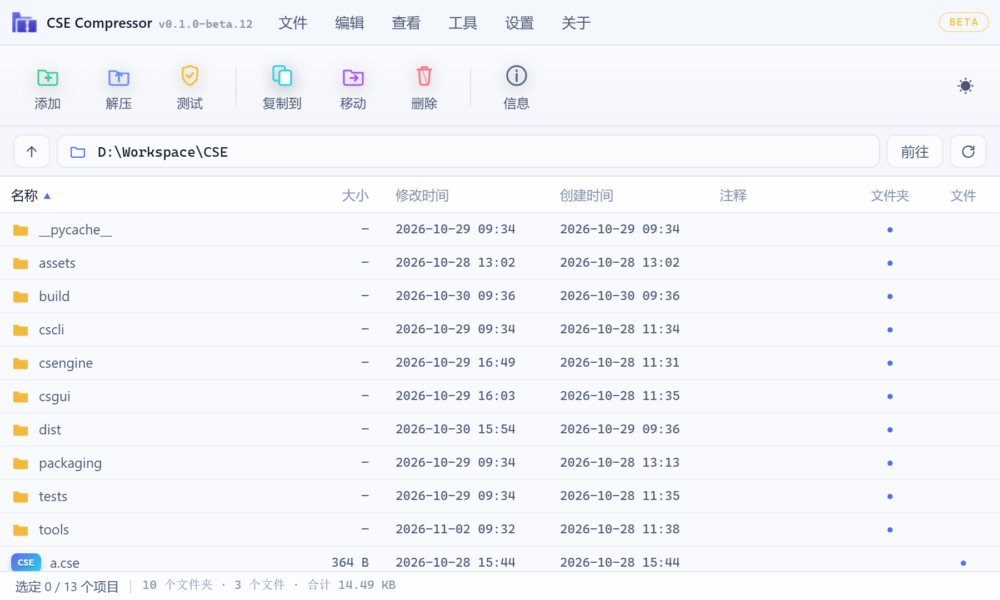
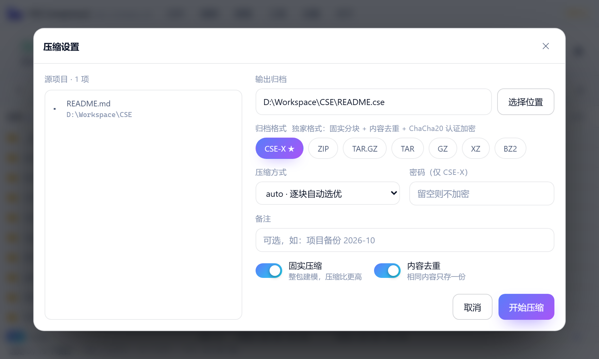

# CSE Compressor

自研压缩引擎 + 多格式互操作 + 独家 CSE-X 格式 + 现代化 Windows 桌面应用。

压缩算法是自己写的（LZ77 + 规范化哈夫曼 + ChaCha20 加密 + 固实分块去重），不走 `zlib` 的现成实现；界面是一体化无边框窗口（pywebview + WebView2），配独立安装程序与资源管理器右键菜单集成。

[](https://github.com/JeaCh0115/CSE-Compressor/actions/workflows/ci.yml)
[](LICENSE)
[](https://www.python.org/)

**当前版本：`0.1.0-beta.13`（Beta）** — 版本按 `主.次.修订-beta.N` 演进，每次打包把构建时间与构建号烧进发行件（关于对话框可见）。

[下载安装包](https://github.com/JeaCh0115/CSE-Compressor/releases) · [从源码运行](#快速开始) · [命令行](#命令行)

## 界面





## 快速开始

需要 Windows 10/11 + Python 3.10+（WebView2 运行时 Win11 自带，Win10 通常也已安装）。

```bash
git clone https://github.com/JeaCh0115/CSE-Compressor.git
cd CSE-Compressor
python -m venv .venv && .venv\Scripts\activate
pip install -r requirements.txt

python run.py app                    # 桌面应用（原生窗口）
python run.py ui                     # 浏览器模式（不装 pywebview 也能用）
python run.py c 我的目录 -o 备份.cse   # 命令行压缩
```

只想用不想配环境：到 [Releases](https://github.com/JeaCh0115/CSE-Compressor/releases) 下载 `Setup.exe` 或 `Portable.zip`。

> 引擎与 CLI **只用标准库**，一条 `pip install` 都不装也能压缩/解压/校验；`requirements.txt` 里的三个包只服务图形界面与 7z 互操作。

## 项目结构

```
CSE/
├── csengine/           # 压缩引擎（核心）
│   ├── bitio.py        #   位级读写流（LSB-first）
│   ├── lz77.py         #   自研 LZ77 滑动窗口（32KB 窗口 / 4-259 匹配）
│   ├── huffman.py      #   规范化哈夫曼编码（LSB-first 位反转适配）
│   ├── compressors.py  #   多后端调度: store / lzhuf / zlib / lzma / auto
│   ├── archive.py      #   .cse v1 容器（兼容保留）
│   ├── crypto.py       #   ChaCha20 + HMAC-SHA256 认证加密（RFC 8439）
│   ├── exclusive.py    #   ★ CSE-X 独家格式（CSX2）
│   ├── converters.py   #   多格式统一入口: cse/zip/tar/tar.gz/gz/bz2/xz/7z
│   ├── formats.py      #   格式化模块: 魔数识别 / 大小格式化 / hexdump
│   ├── version.py      #   版本与构建信息（Beta 渠道单一真源）
│   ├── _opensource.py  #   开源项目清单与致谢（关于对话框）
│   └── winassoc.py     #   .cse 文件关联（HKCU，免管理员）
├── cscli/main.py       # 命令行工具（打包为 cse-cli.exe）
├── csgui/
│   ├── server.py       # 本地 Web 服务 + JSON API（关于/设置/系统集成）
│   ├── desktop.py      # ★ 桌面外壳：原生窗口 + 任务栏 + 单实例 + DPI
│   ├── settings.py     # 用户设置持久化（%APPDATA%\CSE Compressor）
│   ├── web/            # 单页前端（菜单栏 / 玻璃拟态 / 拖拽 / 进度）
│   └── app.py          # 旧版 Tkinter 界面（保留）
├── packaging/          # Windows 打包：应用入口 / 安装器 / 版本资源
├── assets/icons/       # 应用图标 + 全格式文件图标族（tools/make_icons.py 生成）
├── tests/              # 97 个单元测试
├── tools/
│   ├── dev_pipeline.py # 全自动开发流水线
│   ├── build_win.py    # 一键打包：exe + 便携版 + 独立安装程序
│   ├── make_icons.py   # 图标族生成
│   ├── ui_probe.py     # 界面回归 55 项（Edge headless + CDP）
│   ├── window_probe.py # 原生窗口 11 项（尺寸/样式位/四边命中/真实拖动）
│   ├── frame_probe.py  # 启动首帧：断言「先出画后亮窗」（无黑屏）
│   ├── visible_probe.py # 可见性时间线（5ms 采样，查有没有提前闪一下）
│   ├── assoc_probe.py  # 文件关联：问外壳实际会启动哪个 exe
│   ├── compact_probe.py # 右键压缩小窗：布局完整性 + 全流程（设置→进度→完成）
│   ├── compact_ready_probe.py # 小窗「一次到位」：屏幕外预热、屏内无空白帧、面板已就绪
│   ├── compact_test_probe.py # 小窗「完整性测试」不能把小窗关掉（点完窗口还在 + 结果面板）
│   ├── clash_probe.py   # 输出归档不许与源文件同名（zip 源压 ZIP 不再截断源文件）
│   ├── overwrite_probe.py # 目标已存在必须提醒：另存/覆盖两条路都不许静默替换文件
│   ├── compact_overwrite_probe.py # 小窗里的提醒条与确认层不撑出滚动条
│   ├── dialog_fit_probe.py # 主界面压缩对话框带提醒条仍一页放完
│   ├── release_overwrite_smoke.py # 发行件冒烟：便携版里的三个新接口与前端确认层都在
│   ├── tooltip_probe.py # 窗口按钮不弹「最小化」黑框提示（hover 前后像素差）
│   ├── setup_probe.py  # 安装程序真机探针：屏幕外热身/不闪白/尺寸/底色（PrintWindow）
│   ├── setup_flow_probe.py # 安装界面流程自检（CDP：安装→进度→完成，卸载同理）
│   ├── setup_preview.py # 安装界面静态预览（headless Edge 截 5 个视图）
│   ├── shot_window.py  # 抓真实窗口截图（ctypes + PIL，无需浏览器）
│   ├── bench_compress.py # 压缩吞吐基准
│   └── startup_probe.py  # 冷启动耗时
├── docs/screenshots/   # README 用的界面图（tools/readme_shot.py 生成）
├── .github/workflows/  # CI：Windows 上编译 + 97 项单测 + CLI 冒烟
├── requirements.txt    # 运行依赖（引擎与 CLI 零依赖）
├── CONTRIBUTING.md     # 开发约定 / 探针使用说明
└── run.py              # 统一启动器
```

## ★ CSE-X 独家格式（.cse，魔数 CSX2）

| 能力 | 说明 |
|---|---|
| 固实分块 | 小文件拼成大块统一压缩，跨文件冗余一起吃掉 |
| 内容去重 | ≤8MB 文件按 SHA-256 识别，相同内容只落一份 |
| 认证加密 | PBKDF2(120k) 派生密钥 + ChaCha20 流加密 + HMAC 篡改检测 |
| 元数据 | 保留修改时间 / 权限 / 备注，解压自动还原 |
| 逐块选优 | auto 模式对每个数据块独立挑选最优压缩方法 |
| 完整性 | 每块 CRC32 校验，旧版 CSE1 归档仍可读取 |

## 桌面应用（Windows）

```bash
python run.py app        # 原生窗口（pywebview + Edge WebView2）
python run.py ui         # 浏览器模式（同一界面）
```

- **菜单栏**：文件（添加/打开/解压/拖入缓存管理）、工具（完整性测试/格式识别/.cse 文件关联/图标缓存刷新）、设置（主题/默认格式/默认压缩方式/固实与去重，持久化到 `%APPDATA%\CSE Compressor\settings.json`）、关于（版本/打包时间/构建号/开源项目/致谢/检查更新）
- **文件列表**：单击列头排序（名称/大小/修改时间/创建时间，再次点击切升降序，选择记忆在本地），文件夹恒在前
- **窗口行为**：独立任务栏图标，点击任务栏图标可最小化/还原；Per-Monitor DPI 感知；标题栏明暗跟随主题；记住窗口尺寸/位置/最大化状态；**启动无黑屏**（窗口以隐藏态建出，启动页画出首帧才亮出来，底色与启动页同色）
- **单实例**：重复启动自动唤起已有窗口；双击 `.cse` 归档（文件关联）直接打开查看；资源管理器右键一键解压（解压动词是 `MultiSelectModel=Single`：只有单选一个归档时才出现，多选几个文件时不会冒出来）
- **多选右键压缩**：资源管理器对每个选中项各调起一次进程（`%1` 动词），入口用命名互斥锁选举主实例，其余进程把路径转发过去后退出——N 个文件仍然只有一个窗口、一个压缩列表
- **冷启动**：右键「压缩」到窗口出现约 1.3 秒（判定"是否已有实例"走 `runtime.json` + 监听端口枚举，不再逐个端口 connect）
- **压缩不卡界面**：auto 不再把纯 Python 的 `lzhuf` 拉进候选（一块 2MB 要 700ms 且长期霸占 GIL，拖窗口直接卡成幻灯片）；改为「头/中/尾采样挑方法 + 整块只压一次」，2MB 文本块 700ms → 20ms、不可压数据 4.9s → 30ms；分块压缩走线程池并行、按提交顺序落盘，压不动就 store
- **统一压缩包图标与打开方式**：每种扩展名一个独立 ProgID（`CSE.Archive.zip` / `.7z` …），自带图标、`open` 命令与解压动词，再把扩展名关联过去并清掉旧的 `UserChoice`——图标和「双击用谁打开」一起接管。Windows 10/11 会保护部分类型的默认应用（首次需要用户在系统「默认应用」里确认一次），程序会把实际接管结果如实报出来，并提供「打开系统「默认应用」设置」入口
- **不抢焦点观感**：界面默认不画焦点框（打开软件/弹对话框时不会"莫名其妙选中一个按钮"），只在用户按过 Tab（键盘导航）时显示品牌色焦点环；对话框打开后焦点落在对话框本体上，Enter 直接开始压缩/解压
- **右键压缩/解压只弹小窗**：资源管理器右键「压缩」不再先弹主界面——直接按 560×560 小窗只显示压缩设置（左栏源项目自带滚动，右栏设置项一页放完，不出滚动条）；右键「解压」按 540×420 小窗先问「解压到哪」（默认归档同级的 `名称_解压`，可改路径或点「选择位置」选文件夹）。小窗先建在屏幕外、面板画好才挪到中央，不会先闪一块空白；小窗里点「完整性测试」只把面板换成进度/结果，不会连窗口一起退掉；完成后原地显示结果（打开所在文件夹 / 打开主界面 / 完成），「打开主界面」会把小窗还原成常规主界面继续管理文件
- **输出归档不与源文件同名**：源本身就是 `x.zip`、格式又选 ZIP（或 `.gz` 源压 gz）时，默认输出名会自动改成 `x_压缩.zip`；万一手动填了同名，点「开始压缩」前会被拦下并改名。引擎层也硬拦（zipfile / tarfile / gzip 都是先截断目标再回读源，同名会把源文件当场清空）
- **覆盖前一定要提醒**：输出归档或解压目标已经存在时不再静默替换——压缩默认自动改名（`报告.zip` → `报告_压缩.zip`）并在输出框下面挂提醒；手动改回原名点「开始压缩」会弹出确认层，默认按钮是「另存为」（覆盖要另外点一次红色按钮）。解压时先数出目标目录里有多少同名文件会被顶掉，选「换个文件夹」就两者都留着。界面之外还有第三道闸：引擎 `create(overwrite=False)` 在目标存在时直接报错，前端判断漏了也不会毁数据
- **拖入文件缓存**：拖放只能拿到文件内容、拿不到原始路径，所以拖入的文件先复制到 `~/.cse_upload/<会话>/` 再压缩；压缩完成后这批副本自动删掉，也可以在「文件」菜单里手动查看/清空缓存

- **快捷键**：Ctrl+O / Ctrl+Shift+O（添加文件/文件夹）、Ctrl+L（打开归档）、Ctrl+E（解压）、Ctrl+T（完整性测试）、Ctrl+I（格式识别）、Alt+F/T/S/A（菜单）

## Windows 发行件

```bash
python tools/build_win.py --verify
```

| 产物 | 说明 |
|---|---|
| `dist/CSE-Compressor-<版本>-Setup.exe` | 独立安装程序：自研安装向导（浅色紧凑单卡片 ~600×410，窗口按钮不带原生悬浮提示，安装位置/开始菜单/桌面快捷方式/.cse 关联）、覆盖升级、注册表卸载信息、图形化卸载器、`--silent` 静默模式。窗口先在屏幕外热身、内容画好再挪到中央（打开不闪白） |
| `dist/CSE-Compressor-<版本>-Portable.zip` | 便携版，解压即用 |
| `assets/icons/` | 应用图标 `cse-app.ico` + CSE/ZIP/7Z/RAR/TAR/GZ/BZ2/XZ 文件图标族（.ico 多分辨率 16-256） |

安装后命令行 `cse-cli.exe` 与图形界面同引擎；安装/卸载自检内置于 `build_win.py --verify`。

## 命令行

```bash
python run.py c 目录 -o 输出.cse -p 密码            # CSE-X 固实+去重+加密
python run.py c 目录 -o 输出.zip -f zip            # 转 ZIP 格式
python run.py x 任意归档 -o 目录 [-p 密码]          # 自动识别格式解压
python run.py l 任意归档 [-p 密码]                 # 列出内容（压缩率对比）
python run.py t 任意归档                           # 完整性测试
python run.py info 任意文件                        # 格式识别
```

## 全自动开发流水线

```bash
python tools/dev_pipeline.py             # 常规 8 步
python tools/dev_pipeline.py --win       # 追加：exe+安装程序打包与安装/卸载自检
```

一键执行：**clean → compile → 97 项测试 → 压缩率报表 + CSE-X 能力对比 → 7 格式互操作矩阵 → 界面服务全链路冒烟（菜单栏/关于/设置 API/上传/加密压缩/预览/解压）→ 桌面外壳导入自检 →（--win）Windows 打包 → dogfood 打包发布件**，任一环节失败即中止。

## 参与开发

```bash
pip install -r requirements-dev.txt
python -m unittest discover -s tests -v   # 97 项单元测试，纯标准库，无需图形环境
python tools/ui_probe.py                  # 界面端到端回归 55 项（用真实 Edge + CDP 驱动）
```

仓库里 `tools/*_probe.py` 都是**真机探针**：建真窗口、发真鼠标事件、抓真像素，用来验证"启动不闪白""小窗不空白""按钮不弹原生提示"这类光看代码看不出来的问题。想在本地跑其中任何一个，先读它的 docstring——有几个需要前台窗口（锁屏或远程桌面下会自行 SKIP）。

提交前的最低要求：`python -m unittest discover -s tests` 全绿，改动涉及界面就再跑一次 `tools/ui_probe.py`。详见 [CONTRIBUTING.md](CONTRIBUTING.md)。

## 开源协议

[MIT](LICENSE) © 2026 JeaCh0115

第三方依赖与参考实现列在程序「关于」对话框（`csengine/_opensource.py`）里，一并致谢。
